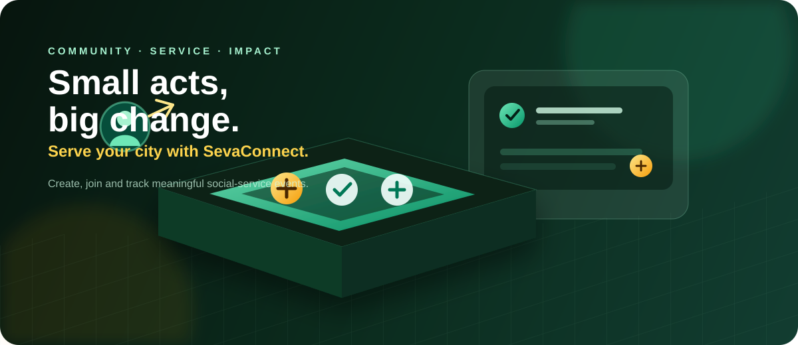

<div align="center">
  

  <h1>SevaConnect</h1>
  <p><strong>A modern community-driven platform for creating, joining and tracking social-service events.</strong></p>

  <p>
    <a href="https://github.com/MAHFUJ-7/Assignment-8-client"></a>
    <a href="#live-demo"></a>
  </p>

  <p>
    
    
    
    
    
  </p>
</div>

<br />

## ✨ About SevaConnect

SevaConnect makes it easy for local communities to turn good intentions into organized action. Organizers can publish service events, volunteers can discover opportunities nearby, and every participant can keep track of their commitments in one friendly platform.

> **Built around one idea:** small acts become meaningful change when people can find each other.

## 🌱 Highlights

- **Create meaningful events** — publish cleanup drives, plantations, donations, health camps, food drives and winter-relief initiatives.
- **Discover upcoming opportunities** — browse responsive event cards with date, location, category, volunteer capacity and cover images.
- **Join with confidence** — one-click joining, duplicate-join protection and leave-event support.
- **Manage your own events** — update or delete only the events you created.
- **Protected authentication** — email/password authentication, Google sign-in, password validation and session-aware private routes.
- **JWT-protected APIs** — sensitive create, update, delete, join and user-event endpoints require a signed token.
- **Personal profile** — update your display name and profile image from the member profile page.
- **Light and dark themes** — switch the complete interface between a fresh mint light theme and a deep green dark theme.
- **Responsive by design** — polished layouts for phones, tablets and desktop screens.

## 🧭 Main routes

| Route | Access | Purpose |
| --- | --- | --- |
| `/` | Public | Hero banner, features, recent events, gallery and newsletter section |
| `/upcomming-events` | Public | Browse and filter future events |
| `/view/[id]` | Public | Read event details and join when authenticated |
| `/sign-in` | Public | Email/password and Google sign-in |
| `/sign-up` | Public | Account creation with password rules |
| `/create_event` | Private | Create a future community-service event |
| `/manage_event` | Private | Edit and delete your own events |
| `/joined_events` | Private | View joined events sorted by event date |
| `/profile` | Private | View and update member details |

## 🎨 Experience

- Animated 3D-inspired project identity
- Modern emerald, teal and amber visual system
- Responsive navbar with active-route states
- Profile dropdown with member actions
- Toast feedback instead of browser alerts
- Empty, error and loading states across data-driven pages
- Consistent card, button, image and spacing patterns

## 🧰 Technology

### Client

- Next.js 16 App Router
- React 19
- JavaScript / JSX
- Tailwind CSS v4
- HeroUI, shadcn/ui and Base UI primitives
- Better Auth with MongoDB adapter
- React Toastify

### Server

- Express 5
- MongoDB driver
- JSON Web Token authentication
- CORS and dotenv

## 🚀 Getting started

### 1. Install the client

```bash
cd Client-Side
npm install
```

### 2. Configure client environment variables

Create `Client-Side/.env`:

```env
BETTER_AUTH_SECRET=replace-with-a-long-random-secret
BETTER_AUTH_URL=http://localhost:3000
NEXT_PUBLIC_BETTER_AUTH_URL=http://localhost:3000
BETTER_AUTH_TRUSTED_ORIGINS=http://localhost:3000,http://127.0.0.1:3000
BETTER_AUTH_DATABASE_URL=your-mongodb-connection-string
BETTER_AUTH_GOOGLE_CLIENT_ID=your-google-client-id
BETTER_AUTH_GOOGLE_CLIENT_SECRET=your-google-client-secret
NEXT_PUBLIC_SERVER_BASE_URL=http://localhost:5000
```

`BETTER_AUTH_DATABASE_URL` is required by the client deployment. The application also accepts `AUTH_MONGODB_URL` as a fallback for deployments that reuse the server variable name.

For production, set `BETTER_AUTH_URL` and `NEXT_PUBLIC_BETTER_AUTH_URL` to the deployed client URL, and set `BETTER_AUTH_TRUSTED_ORIGINS` to that same URL. `NEXT_PUBLIC_SERVER_BASE_URL` must be the deployed Express API URL, not the client or Next.js deployment URL. Do not include a trailing slash.

### 3. Install and configure the server

```bash
cd Server-Side
npm install
```

Create `Server-Side/.env`:

```env
PORT=5000
AUTH_MONGODB_URL=your-mongodb-connection-string
ACCESS_TOKEN_SECRET=replace-with-a-long-random-secret
```

### 4. Run both applications

In the server directory:

```bash
node index.js
```

In the client directory:

```bash
npm run dev
```

Open [http://localhost:3000](http://localhost:3000).

## ✅ Validation

The client production build is verified with:

```bash
npm run build
```

The project validates:

- Authentication fields and password complexity
- Event title, description, image URL, phone and volunteer count
- Future event dates on create and update forms
- Duplicate event joins
- Authenticated ownership for event management

## 🔐 Security notes

- Never commit `.env` files or credentials.
- Use separate strong secrets for Better Auth and API JWT signing.
- Configure production callback URLs for Google OAuth.
- Replace local URLs with deployed client and server URLs before publishing.

## 🌍 Live demo

The deployment URL should be added here after hosting:

**Live site:** `https://your-deployed-client-url.example`

**Client repository:** [MAHFUJ-7/Assignment-8-client](https://github.com/MAHFUJ-7/Assignment-8-client)

**Server repository:** Add the deployed server repository link here.

## 📄 License

This project was created for educational purposes as part of a community event-management assignment.
